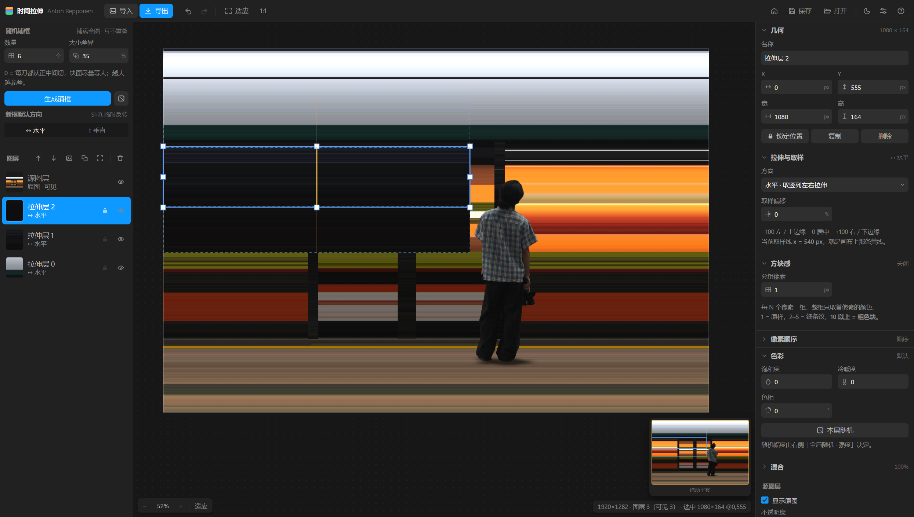

# 时间拉伸 · Anton Repponen 风格化工具

把一张照片沿水平方向「撕开拉宽」的小工具。

在画面上框一个矩形，矩形内自动取**水平正中那一列竖向像素**，左右横向拉伸铺满整个矩形 —— 中央主体保持原样，四周被时间拉长成超现实的横向色带。

灵感来自纽约艺术家 **Anton Repponen** 的概念摄影系列《Time Stretch》。纯前端实现，图片全程不离开本机。

**[→ 在线使用（免安装）](https://theliangsui.github.io/time-stretch/)** · **[→ 下载 Windows 桌面版](https://github.com/TheLiangSui/time-stretch/releases/latest)**



---

## 打开即用

| 版本 | 怎么用 | 说明 |
|---|---|---|
| 🌐 **网页版** | 打开 [theliangsui.github.io/time-stretch](https://theliangsui.github.io/time-stretch/) | 打开即用，无需安装、不加载任何外部资源。单文件，也可以下载 `index.html` 双击本地打开 |
| 🖥 **Windows 桌面版** | [Releases](https://github.com/TheLiangSui/time-stretch/releases/latest) 下载 `TimeStretch-v2.0.0-win32-x64.zip` → **解压整个文件夹** → 双击 `TimeStretch.exe` | 免安装绿色版。多出原生「另存为」对话框、默认目录记忆、原生菜单 |

> ⚠️ 桌面版**必须解压后整个文件夹放在一起**运行。`TimeStretch.exe` 依赖同目录的 Electron 运行时，单独把 exe 拖出来会打不开。
> 想放桌面就给它建快捷方式。
>
> 首次运行 Windows 可能弹「Windows 已保护你的电脑」—— 这是未做代码签名的正常提示。点**更多信息 → 仍要运行**即可。

两个版本共用**同一份 `index.html`**，功能完全一致。

---

## 效果原理

```
原始图片                       框选矩形 (x, y, w, h)              渲染结果
┌─────────────────┐           ┌─────────────────┐               ┌─────────────────┐
│                 │           │    ┌───────┐    │               │    ┌───────┐    │
│      ·          │   ──►     │    │   │   │    │      ──►      │    │███████│    │
│                 │           │    │  ↑采样 │    │               │    │███████│    │
│                 │           │    │  列   │    │               │    │███████│    │
│                 │           │    └───────┘    │               │    └───────┘    │
└─────────────────┘           └─────────────────┘               └─────────────────┘
                              取矩形内水平居中的一列           把这一列横向放大到
                              (1px 宽，贯穿矩形全高)            整个矩形宽度
```

结果：矩形内每一行像素 = 源图那一行在采样列处的颜色，横向完全均匀。天空这类纵向渐变拉伸后看不出变化，而楼、树、文字这类有横向细节的地方会被压成色带 —— 正是 Repponen 那个味道。

**核心原则：每个拉伸层的采样列永远从源图层（原图）读，绝不读合成中间结果。** 叠加再多层也不会累积失真，z 序只决定「谁盖住谁」。

---

## 功能

- **拖拽即出效果** —— 按下拖动时就实时预览，松手成型；`Shift` 临时切换水平 / 垂直
- **多图层叠加** —— 允许互相重叠，`Alt` + 点击穿透到下一层，图层可排序、分组、锁定、隐藏、重命名
- **方块感**（1–100 行分组）—— 把纵向像素按 N 行一组压平，越大越像素化
- **像素顺序** —— 顺序 / 乱序 / 间序三种置换，乱序是完整置换，只换排列不增删颜色
- **饱和度 · 冷暖度** —— 逐像素调色，支持一键随机（`R`）与随机强度
- **取样偏移** —— 采样列按半宽百分比左右微调
- **批量生成框** —— 随机铺框：铺满全图、互不重叠，可调数量与大小差异
- **数值两种拖法** —— 拖参数前的小图标按步长走；拖数值下的数据条按指针位置直接取值，条永远跟手
- **画布** —— Ctrl+滚轮缩放、右键 / 空格 / 中键拖拽平移、小地图导航
- **工程** —— `.json` 内嵌原图与全部图层参数，`Ctrl+S` / `Ctrl+O`，本地项目库 + 启动页
- **撤销 / 重做** —— 上限 80 步
- **深色 / 浅色主题、UI 缩放**（1 / 1.15 / 1.3）、`Ctrl+\` 一键隐藏界面只看图

完整交互说明见 [技术规格 · 第 5 节](docs/技术规格.md)。

---

## 常用快捷键

| 操作 | 效果 |
|---|---|
| 拖拽空白处 | 新建拉伸层（拖动中实时预览） |
| `Alt` + 点击 | 穿透选中下一层 |
| `Ctrl+Z` / `Ctrl+Shift+Z` | 撤销 / 重做 |
| `Ctrl+C` / `Ctrl+V` | 复制 / 粘贴图层（连续粘贴自动错开） |
| `Ctrl+Shift+V` | 从系统剪贴板粘贴图片 |
| `[` / `]` | 图层下沉 / 上浮 |
| `L` / `E` / `R` | 锁定位置 / 显示隐藏 / 随机调色 |
| `Ctrl` + 滚轮 | 以指针为中心缩放 |
| `Ctrl+0` / `Ctrl+1` | 适应窗口 / 原始像素 |
| `Ctrl+S` / `Ctrl+O` | 保存 / 打开工程 |

---

## 自己构建

```bash
npm install                       # 首次；Electron 二进制建议走 npmmirror 镜像
node dev/make-icon.js             # 生成 icon.ico
node dev/build-portable.js        # 组装 dist/时间拉伸-win32-x64/
npm start                         # 不打包，直接以 Electron 调试
```

`dev/build-portable.js` 不走 electron-packager：`node_modules/electron/dist` 里已经有解压好的运行时，用 `robocopy` 直接拷过去 0.1 秒完事，再用纯 JS 的 `resedit` 把图标和版本信息写进 PE。相比标准打包的「解压 157MB → 再拷 368MB」快两个数量级。

> **发行包为什么把 exe 叫 `TimeStretch.exe`**：ZIP 的文件名编码没有强制标准，Windows 资源管理器不认 UTF-8 标志位（bit 11），只会按系统 ANSI 代码页解码。中文名在中文系统上正常、在英文系统上必乱码，反过来也一样。发行包里顶层目录和 exe 统一用 ASCII，任何系统任何解压工具都不会出岔子 —— 应用界面上仍然是「时间拉伸」。本地构建产物保持 `时间拉伸.exe`，两者只是命名不同。

### 自测

374 条断言，覆盖取样位置、方块分组、调色、撤销、图层栈、下拉 / 弹窗 / 缩放条、渲染调度等 UI 行为，用本机 Edge 无头模式跑：

```bash
npm run check                     # 构建 + 生成测试页 + 跑全套
```

```
TOTAL=374 FAILS=0 VERDICT=ALL_PASS
```

生成器还支持故意破坏（`node _gen_selftest.js broken`）—— 把采样列强制挪到矩形左边缘，用来验证测试本身抓得住错误，而不是一路绿灯。

**跑不满会报错。** `_run_selftest.js` 有三道闸门：用例数低于下限、页面出现未捕获异常 → `VERDICT=TRUNCATED` 且 exit 2；有 FAIL → exit 1。没有这道闸门时，一段测试静默不跑的表现是「零 FAIL、总数腰斩」，排查代价极高。

---

## 目录

```
src/template.html   外壳结构（CSS / JS 用占位标记）
src/styles.css      全部样式
src/js/*.js         27 个按职责分节的模块（状态 / 取样 / 图层数据 / 图层视图 / 手势 / 输入 / IO ...）
dev/build-single.js 把 src/ 拼回一个 index.html
index.html          构建产物：网页版与桌面版共用的单文件（零外部依赖，别手改）
main.js             Electron 主进程：窗口、原生另存为、菜单、设置持久化
preload.js          contextBridge 暴露最小 IPC 接口
package.json        Electron 配置
icon.ico            应用图标（7 种尺寸）
dev/                构建、自测、静态检查、DOM 快照、布局体检脚本
docs/               技术规格 + 重构记录
```

### 改代码的工作流

```bash
# 只改 src/ 下的文件；index.html 是构建产物，手改会在下次构建时被覆盖
npm run check        # 静态检查 → CSS 变量扫描 → 构建 → 374 项自测（任一步失败即非 0 退出）
npm run lint         # 只跑静态检查
npm run check:css    # 只扫未定义的 CSS 变量
```

静态检查用 ESLint 的「查错」规则（`no-undef` / `no-redeclare` / `no-dupe-keys` / …），
先把 27 个模块拼成一份再查 —— 它们是同一个 IIFE 的片段，逐文件解析不出来。
检查器自带自检：先喂人造错误确认规则真的会报，再查代码。

面板类代码用 `h()`（`src/js/00b-DOM构造.js`）直接建节点，**不要**再拼 HTML 字符串：
拼字符串要靠 id 再找回来，写错一个字就是 `null`，且不会报错。

---

## 校验下载

Release 页同时提供 `SHA256SUMS.txt`。Windows 上校验：

```powershell
Get-FileHash .\TimeStretch-v2.0.0-win32-x64.zip -Algorithm SHA256
```

当前版本应为：

```
00c481f70582d616e315192d427d51a2921046e9e3425c64d8c9e6add05eafcf
```

不一致说明下载被截断或损坏，重新下载。

---

## 已知边界

- 不支持**旋转**矩形 —— 取样线必须轴对齐，「居中列 / 居中行」的定义才成立
- 矩形不能超出图像范围，超出部分没有源像素可采，会被裁掉
- 导出倍率只有 0.5x / 1x / 2x，2x 是纯上采样，不增加真实细节
- 工程 JSON 内嵌原图 PNG dataURL，4000×3000 的大图可能到几十 MB，属正常现象
- 网页版用不了「设置 · 默认目录」（浏览器没有文件系统权限），面板里会有明确提示
- 取样偏移的 −100 / +100 是**半宽百分比**，不是像素值

---

## License

[MIT](LICENSE) © 2026 TheLiangSui

---

<sub>**English** — Time Stretch: a browser + Windows desktop tool that takes the centered vertical pixel column of a rectangle you drag on a photo and stretches it horizontally to fill that rectangle, recreating Anton Repponen's *Time Stretch* concept photography. Single-file HTML, no external resources, images never leave your machine. [Live demo](https://theliangsui.github.io/time-stretch/) · [Windows build](https://github.com/TheLiangSui/time-stretch/releases/latest). MIT licensed.</sub>

## v3 新增：色相 / 图片图层 / 抠图（2026-11-01）

**色相**：色彩组里多一格「色相」（-180°~180°，可拖图标）。走画布的 `filter: hue-rotate()`，
一次 drawImage 完成，不做逐像素 HSL —— 逐像素在 4000px 图上每次调参都要重算，太慢。
代价：CSS 的 hue-rotate 是矩阵近似，饱和色旋转后会掉亮度（纯红转 120° 得到 rgb(0,113,0)，
不是纯绿），需要时用「饱和度」补回来。

**图片图层**：图层列表头的图片按钮导入 png/jpg/webp，按原尺寸落进画布（超过画布就缩到 90%
以内、居中），保留透明通道。图片层不走取样拉伸，面板里三个拉伸组自动隐藏；色彩、不透明度、
混合模式、合并形状照常可用。

位图用「不可枚举属性 + id 注册表」存：`img` 不参与 JSON，撤销快照不会背上几 MB base64；
撤销/复制后从 `IMG_REG` 按 id 挂回去。存工程时单独转 dataURL，读盘时先并行解码再建层。

**自动抠图（实验）**：外圈 6% 取样估背景色与离散度，容差随背景离散度自适应，再从四条边做
连通洪水，最后低分辨率蒙版平滑放大当 alpha。

为什么不是 AI 模型：u2netp / RMBG / ISNet 都试过路线，权重 4.6MB 起，GitHub Release 资源
在 file:// 页面被 CORS 拦死（实测 `Failed to fetch`），HuggingFace 源又常 502，jsDelivr 只
能取仓库/npm 里的文件。要接模型得自带一个 models 目录一起分发，破坏了「单文件自包含」。
所以先用本地算法顶上，标成实验功能。它只对「主体与背景色差明显」的图有效。
