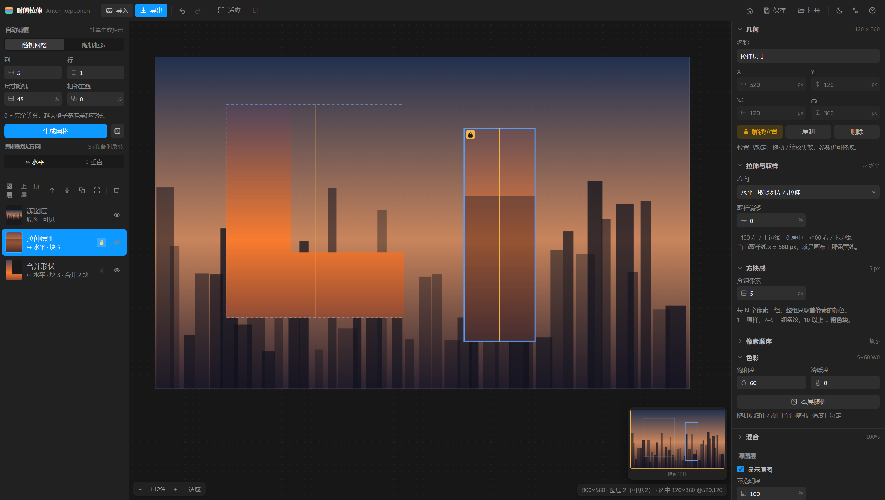

# 时间拉伸 · Anton Repponen 风格化工具

把一张照片沿水平方向「撕开拉宽」的小工具。

在画面上框一个矩形，矩形内自动取**水平正中那一列竖向像素**，左右横向拉伸铺满整个矩形 —— 中央主体保持原样，四周被时间拉长成超现实的横向色带。

灵感来自纽约艺术家 **Anton Repponen** 的概念摄影系列《Time Stretch》。纯前端实现，图片全程不离开本机。

**[→ 在线使用（免安装）](https://theliangsui.github.io/time-stretch/)** · **[→ 下载 Windows 桌面版](https://github.com/TheLiangSui/time-stretch/releases/latest)**



---

## 打开即用

| 版本 | 怎么用 | 说明 |
|---|---|---|
| 🌐 **网页版** | 打开 [theliangsui.github.io/time-stretch](https://theliangsui.github.io/time-stretch/) | 打开即用，无需安装、不加载任何外部资源。单文件，也可以下载 `index.html` 双击本地打开 |
| 🖥 **Windows 桌面版** | [Releases](https://github.com/TheLiangSui/time-stretch/releases/latest) 下载 `时间拉伸-v2.0.0-win32-x64.zip` → **解压整个文件夹** → 双击 `时间拉伸.exe` | 免安装绿色版。多出原生「另存为」对话框、默认目录记忆、原生菜单 |

> ⚠️ 桌面版**必须解压后整个文件夹放在一起**运行。`时间拉伸.exe` 依赖同目录的 Electron 运行时，单独把 exe 拖出来会打不开。
> 想放桌面就给它建快捷方式。

两个版本共用**同一份 `index.html`**，功能完全一致。

---

## 效果原理

```
原始图片                       框选矩形 (x, y, w, h)              渲染结果
┌─────────────────┐           ┌─────────────────┐               ┌─────────────────┐
│                 │           │    ┌───────┐    │               │    ┌───────┐    │
│      ·          │   ──►     │    │   │   │    │      ──►      │    │███████│    │
│                 │           │    │  ↑采样 │    │               │    │███████│    │
│                 │           │    │  列   │    │               │    │███████│    │
│                 │           │    └───────┘    │               │    └───────┘    │
└─────────────────┘           └─────────────────┘               └─────────────────┘
                              取矩形内水平居中的一列           把这一列横向放大到
                              (1px 宽，贯穿矩形全高)            整个矩形宽度
```

结果：矩形内每一行像素 = 源图那一行在采样列处的颜色，横向完全均匀。天空这类纵向渐变拉伸后看不出变化，而楼、树、文字这类有横向细节的地方会被压成色带 —— 正是 Repponen 那个味道。

**核心原则：每个拉伸层的采样列永远从源图层（原图）读，绝不读合成中间结果。** 叠加再多层也不会累积失真，z 序只决定「谁盖住谁」。

---

## 功能

- **拖拽即出效果** —— 按下拖动时就实时预览，松手成型；`Shift` 临时切换水平 / 垂直
- **多图层叠加** —— 允许互相重叠，`Alt` + 点击穿透到下一层，图层可排序、分组、锁定、隐藏、重命名
- **方块感**（1–100 行分组）—— 把纵向像素按 N 行一组压平，越大越像素化
- **像素顺序** —— 顺序 / 乱序 / 间序三种置换，乱序是完整置换，只换排列不增删颜色
- **饱和度 · 冷暖度** —— 逐像素调色，支持一键随机（`R`）与随机强度
- **取样偏移** —— 采样列按半宽百分比左右微调
- **批量生成框** —— 快速网格（不等分随机切）、随机框选
- **画布** —— Ctrl+滚轮缩放、右键 / 空格 / 中键拖拽平移、小地图导航
- **工程** —— `.json` 内嵌原图与全部图层参数，`Ctrl+S` / `Ctrl+O`，本地项目库 + 启动页
- **撤销 / 重做** —— 上限 80 步
- **深色 / 浅色主题、UI 缩放**（1 / 1.15 / 1.3）、`Ctrl+\` 一键隐藏界面只看图

完整交互说明见 [技术规格 · 第 5 节](docs/技术规格.md)。

---

## 常用快捷键

| 操作 | 效果 |
|---|---|
| 拖拽空白处 | 新建拉伸层（拖动中实时预览） |
| `Alt` + 点击 | 穿透选中下一层 |
| `Ctrl+Z` / `Ctrl+Shift+Z` | 撤销 / 重做 |
| `Ctrl+C` / `Ctrl+V` | 复制 / 粘贴图层（连续粘贴自动错开） |
| `Ctrl+Shift+V` | 从系统剪贴板粘贴图片 |
| `[` / `]` | 图层下沉 / 上浮 |
| `L` / `E` / `R` | 锁定位置 / 显示隐藏 / 随机调色 |
| `Ctrl` + 滚轮 | 以指针为中心缩放 |
| `Ctrl+0` / `Ctrl+1` | 适应窗口 / 原始像素 |
| `Ctrl+S` / `Ctrl+O` | 保存 / 打开工程 |

---

## 自己构建

```bash
npm install                       # 首次；Electron 二进制建议走 npmmirror 镜像
node dev/make-icon.js             # 生成 icon.ico
node dev/build-portable.js        # 组装 dist/时间拉伸-win32-x64/
npm start                         # 不打包，直接以 Electron 调试
```

`dev/build-portable.js` 不走 electron-packager：`node_modules/electron/dist` 里已经有解压好的运行时，用 `robocopy` 直接拷过去 0.1 秒完事，再用纯 JS 的 `resedit` 把图标和版本信息写进 PE。相比标准打包的「解压 157MB → 再拷 368MB」快两个数量级。

### 自测

320 条断言，覆盖取样位置、方块分组、调色、撤销、图层栈、下拉 / 弹窗 / 缩放条等 UI 行为，用本机 Edge 无头模式跑：

```bash
node dev/selftest-gen.js          # index.html → _selftest.html
node dev/selftest-run.js _selftest.html
```

```
TOTAL=320 FAILS=0 VERDICT=ALL_PASS
```

生成器还支持故意破坏（`node dev/selftest-gen.js broken`）—— 把采样列强制挪到矩形左边缘，用来验证测试本身抓得住错误，而不是一路绿灯。

---

## 目录

```
index.html          网页版 / 桌面版共用的全部界面与逻辑（单文件，零外部依赖）
main.js             Electron 主进程：窗口、原生另存为、菜单、设置持久化
preload.js          contextBridge 暴露最小 IPC 接口
package.json        Electron 配置
icon.ico            应用图标（7 种尺寸）
dev/                构建与自测脚本
docs/技术规格.md     完整技术规格 + 逐版本迭代修复记录
```

---

## 校验下载

Release 页同时提供 `SHA256SUMS.txt`。Windows 上校验：

```powershell
Get-FileHash .\时间拉伸-v2.0.0-win32-x64.zip -Algorithm SHA256
```

输出应与 `SHA256SUMS.txt` 中对应行一致。不一致说明下载被截断或损坏，重新下载。

---

## 已知边界

- 不支持**旋转**矩形 —— 取样线必须轴对齐，「居中列 / 居中行」的定义才成立
- 矩形不能超出图像范围，超出部分没有源像素可采，会被裁掉
- 导出倍率只有 0.5x / 1x / 2x，2x 是纯上采样，不增加真实细节
- 工程 JSON 内嵌原图 PNG dataURL，4000×3000 的大图可能到几十 MB，属正常现象
- 网页版用不了「设置 · 默认目录」（浏览器没有文件系统权限），面板里会有明确提示
- 取样偏移的 −100 / +100 是**半宽百分比**，不是像素值

---

## License

[MIT](LICENSE) © 2026 TheLiangSui

---

<sub>**English** — Time Stretch: a browser + Windows desktop tool that takes the centered vertical pixel column of a rectangle you drag on a photo and stretches it horizontally to fill that rectangle, recreating Anton Repponen's *Time Stretch* concept photography. Single-file HTML, no external resources, images never leave your machine. [Live demo](https://theliangsui.github.io/time-stretch/) · [Windows build](https://github.com/TheLiangSui/time-stretch/releases/latest). MIT licensed.</sub>
