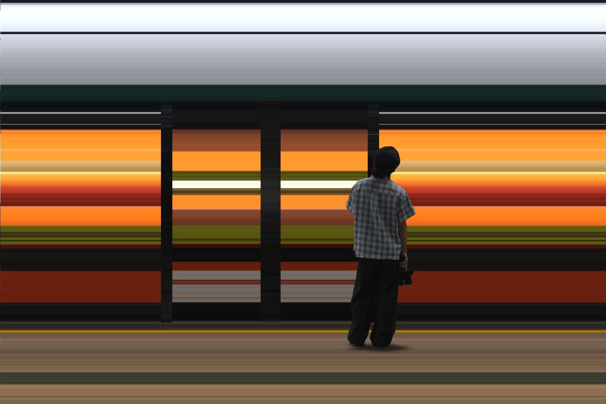
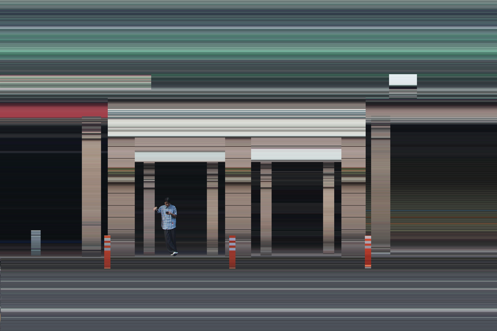

# 时间拉伸 · Anton Repponen 风格化工具

把一张照片沿水平方向「撕开拉宽」。

在画面上框一个矩形，矩形内自动取**水平正中那一列竖向像素**，左右横向拉伸铺满整个矩形 —— 中央主体保持原样，四周被时间拉长成超现实的横向色带。灵感来自纽约艺术家 **Anton Repponen** 的概念摄影系列《Time Stretch》。

纯前端，图片不离开本机。单文件 HTML，零外部依赖。



**[→ 在线使用（免安装）](https://theliangsui.github.io/time-stretch/tools/anton-repponen/)** ·
**[→ Windows 桌面版](https://github.com/TheLiangSui/time-stretch/releases/latest)** ·
**[→ 工具合集首页](https://theliangsui.github.io/time-stretch/)**

---

## 目录

| 内容 | 位置 |
|---|---|
| 在线使用 / 下载 | [本节](#打开即用) |
| 效果原理 | [原理](#效果原理) |
| 实拍作品 | [样片](#实拍样片) |
| 功能详解（10 组） | [功能](#功能详解) |
| 快捷键 | [快捷键](#快捷键) |
| 合集说明 | [合集](#theliangsui-的风格化工具合集) |
| 构建 / 自测 / 目录 | [开发](#自己构建) |
| 已知边界 | [边界](#已知边界) |

---

## 打开即用

| 形态 | 怎么用 | 说明 |
|---|---|---|
| 🌐 **网页版** | 打开 [theliangsui.github.io/time-stretch/tools/anton-repponen](https://theliangsui.github.io/time-stretch/tools/anton-repponen/) | 打开即用，不需要安装，不加载任何外部资源。也可以把 `tools/anton-repponen/index.html` 存到本地双击打开 |
| 🖥 **Windows 桌面版** | 从 [Releases](https://github.com/TheLiangSui/time-stretch/releases/latest) 下载 zip → **解压整个文件夹** → 双击 exe | 免安装绿色版。多出原生「另存为」对话框、默认目录记忆、原生菜单 |

> 桌面版**必须解压后整个文件夹放在一起**运行，exe 依赖同目录的 Electron 运行时，单独拖出来打不开。想放桌面就建快捷方式。
>
> 首次运行 Windows 可能弹「Windows 已保护你的电脑」—— 未做代码签名的正常提示，点 **更多信息 → 仍要运行**。

两个版本共用**同一份 `index.html`**，功能完全一致。

---

## 效果原理

```
原始图片                       框选矩形 (x, y, w, h)              渲染结果
┌─────────────────┐           ┌─────────────────┐               ┌─────────────────┐
│                 │           │    ┌───────┐    │               │    ┌───────┐    │
│      ·          │   ──►     │    │   │   │    │      ──►      │    │███████│    │
│                 │           │    │  ↑采样 │    │               │    │███████│    │
│                 │           │    │  列   │    │               │    │███████│    │
│                 │           │    └───────┘    │               │    └───────┘    │
└─────────────────┘           └─────────────────┘               └─────────────────┘
                              取矩形内水平居中的一列           把这一列横向放大到
                              (1px 宽，贯穿矩形全高)            整个矩形宽度
```

结果：矩形内每一行像素 = 源图那一行在采样列处的颜色，横向完全均匀。天空这类纵向渐变拉伸后看不出变化，而楼、树、文字这类有横向细节的地方会被压成色带 —— 正是 Repponen 那个味道。

**核心原则：每个拉伸层的采样列永远从源图层（原图）读，绝不读合成中间结果。** 叠加再多层也不会累积失真，z 序只决定「谁盖住谁」。

---

## 实拍样片

下面两张都是本人在实景拍摄、再用本工具处理的原片。左侧是站台，右侧是临街建筑立面 —— 同一个动作：把「时间流过」的那一段拉成色带，人物留在原地。




工具里长这样（截图里处理的就是上面那张站台）：


---

## 功能详解

### 1 · 取样与拉伸

| 功能 | 说明 |
|---|---|
| **拖拽即出效果** | 在画布上按下拖出一个矩形，拖动过程中就实时预览，松手成型。黄线是取样线位置，虚线是框 |
| **水平 / 垂直** | 默认左右拉伸（取竖列）；改成上下拉伸（取横行）。拖拽时按住 `Shift` 可临时反转 |
| **取样偏移** | −100 ~ +100，按矩形**半宽百分比**挪动取样线。0 是正中，−100 贴左边缘，+100 贴右边缘。楼群密集时往有细节的一侧挪一点，色带会更丰富 |
| **几何** | 面板里直接输 x / y / w / h，或拖 8 个控制点改大小；拖框内部移动，带 6px 吸附 |
| **锁定位置** | 锁住的层拖不动、不显示控制点，适合已经调好的底图 |

### 2 · 方块感

把取样线上连续的 N 行像素压成同一颜色，N = 1~100。

- `1` 是逐行采样，色带最细最密，接近原图的色彩层次；
- `3~5` 开始出现明显「梯田」感；
- `10` 以上变成宽色块，接近色卡拼贴。

这是控制「照片感 ↔ 平面构成」之间那个刻度的主参数。

### 3 · 像素顺序

取样线上那一列像素怎么排到矩形里，有三种方式：

| 方式 | 效果 |
|---|---|
| **顺序** | 原样铺开，色带与实体一一对应，最忠实 |
| **乱序** | 把像素顺序整体打乱（完整置换，不增不减颜色）。强度 0~100 控制打乱程度，块大小控制几像素一组参与洗牌。种子固定则结果可复现 —— 同一次乱序永远长一样，方便反复微调 |
| **间序** | 按段交错重排，段数可调。出来的是有节律的重复条纹，比纯乱序更「设计」 |

### 4 · 色彩

三层叠加，都是逐层作用在该图层上，不影响其它层：

- **饱和度** −100 ~ +100：压到 −100 变灰，推到 +100 变彩色海报
- **冷暖度** −100 ~ +100：整体往蓝或往橙偏
- **色相** −180° ~ +180°：绕色环旋转。走的是画布 `filter: hue-rotate()`，一次绘制完成，不做逐像素 HSL，4000px 的图上拖动也不卡

> 色相是矩阵近似，饱和色旋转后会掉一点亮度（纯红转 120° 得到的是深绿而不是亮绿）。要补回来用饱和度推一点。

**一键随机**：按 `R` 给选中层随机一组色彩参数，多按几次挑一个。带「随机强度」控制幅度。

### 5 · 图层

- **叠加不限层数**，允许互相重叠，后来的盖住先来的
- **`Alt` + 点击** 穿透选中下一层（矩形重叠时的必备操作）
- **图层合并（合集）**：把几层框成一组，整组一起移动 / 排序 / 隐藏 / 删除
- **多选**：`Shift` 点选、框选多个图层，整组拖动或整组排序
- **不透明度 / 混合模式**：整层透明度与 20 余种混合方式
- **图片图层**：从图层列表头的图片按钮导入 png / jpg / webp，按原尺寸落进画布（超过画布缩到 90% 居中），保留透明通道。图片层不走取样拉伸，色彩、不透明度、混合模式照常可用 —— 用来贴 logo、贴字、贴另一张照片
- **自动抠图（实验）**：外圈取样估背景色，自适应容差，从四条边做连通洪水，生成 alpha 蒙版。只对「主体与背景色差明显」的图有效，复杂背景会糊
- **删源图层**：源图层行悬停出垃圾桶，清空画布回到「等待导入」，换图重来不用重开软件

### 6 · 批量铺满

左侧面板两组批量入口，一次铺满全图：

- **随机切条** —— 铺满全图、互不重叠，可调数量与大小差异，一次出十几条随机色带
- **快速网格** —— 不等分随机切，网格感更规整

配合 `R` 随机调色，几秒钟就能试出十几种构图。

### 7 · 画布与视图

- `Ctrl` + 滚轮以指针为中心缩放，滚轮平移，`Shift` + 滚轮横向平移
- 右键拖拽 / 空格拖拽 / 中键拖拽平移
- 右下角**小地图**：显示整图、各层轮廓和当前视口框，拖动即平移
- `Ctrl+0` 适应窗口，`Ctrl+1` 原始像素
- `Ctrl+\` 一键隐藏所有面板，只看图

### 8 · 工程与项目库

- **工程文件** `.json`：内嵌原图（PNG dataURL）与全部图层参数，`Ctrl+S` / `Ctrl+O` 存取，换机器也能接着改
- **项目库 + 启动页**：工程存在本机 IndexedDB，启动页列出最近工程（带缩略图），点一下继续
- **自动保存**：改完停手约 2 秒自动存进项目库，设置里可关。关掉之后一次都不会自动写盘
- **撤销 / 重做**：上限 80 步，参数拖动、批量生成、图层操作都进栈

### 9 · 导出

- 格式：PNG / JPEG / WebP，JPEG 与 WebP 可调画质
- 倍率：0.5x / 1x / 2x（2x 是上采样，不增加真实细节）
- 背景：透明 / 指定纯色
- 可选是否把源图一起合成进去 —— 关掉就只导出所有拉伸层
- 桌面版弹**原生另存为**，网页版走浏览器下载

### 10 · 界面

- 深色 / 浅色主题，`Ctrl+,` 打开设置
- UI 缩放 1 / 1.15 / 1.3，高分屏不眯眼
- 界面语言参考 Figma：靠填充色分层而不是描边分区，只有分组之间一条 hairline
- 所有数值都能拖：拖参数前的小图标按步长走，拖数值下方的数据条按指针位置直接取值

---

## 快捷键

| 操作 | 效果 |
|---|---|
| 拖拽空白处 | 新建拉伸层（拖动中实时预览） |
| `Shift` + 拖拽 | 临时反转拉伸方向 |
| `Alt` + 点击 | 穿透选中下一层 |
| `Ctrl+Z` / `Ctrl+Shift+Z` | 撤销 / 重做 |
| `Ctrl+C` / `Ctrl+X` / `Ctrl+V` | 复制 / 剪切 / 粘贴图层（连续粘贴自动错开） |
| `Ctrl+Shift+V` | 从系统剪贴板粘贴图片 |
| `Ctrl+D` | 原地复制一层 |
| `[` / `]` | 图层下沉 / 上浮 |
| `L` / `E` / `R` | 锁定位置 / 显示隐藏 / 随机调色 |
| 方向键 / `Shift`+方向键 | 选中层位移 1px / 10px；未选中时平移画布 |
| `Ctrl` + 滚轮 | 以指针为中心缩放 |
| `Ctrl+0` / `Ctrl+1` | 适应窗口 / 原始像素 |
| `Ctrl+\` | 隐藏界面只看图 |
| `Ctrl+S` / `Ctrl+O` | 保存 / 打开工程 |
| `Ctrl+,` | 设置 |
| `Esc` | 取消选中 / 取消正在拖的框 |

---

## TheLiangSui 的风格化工具合集

这个工具是合集里的第一个成员。合集本身是一个外壳：一张卡片对应一个工具，点开就在窗口里运行；后面的空位留给还没做的工具。

- **合集网页版**：[theliangsui.github.io/time-stretch](https://theliangsui.github.io/time-stretch/) —— 一个页面装下所有工具，纯静态
- **合集桌面版**：和工具一起打包成 `TheLiangSui的风格化工具.exe`，工具本体已经打进包里，不依赖任何外部目录

合集用 iframe 托管每个工具，工具仍然是**独立单文件** —— 单独打开、单独发布都行。仓库根目录就是合集（`index.html` 外壳 + `tools/<id>/index.html`），工具源码在 `tools/anton-repponen/`。

---

## 自己构建

```bash
npm install                       # 首次；Electron 二进制建议走 npmmirror 镜像

# 只重建工具本体（改 tools/anton-repponen/src/ 之后跑这个）
npm run build:tool                # src/ 27 个模块 → tools/anton-repponen/index.html

# 检查：静态检查 → CSS 变量扫描 → 重建 → 400 项自测
npm run check:tool

# 合集：收工具 + 内联清单 + 打包桌面版 / 网页版
npm run sync
npm run build                     # → dist/TheLiangSui的风格化工具-win32-x64/
npm run build:web                 # → dist-web/（上传即用）
npm run verify:web                # 起本地服务 + 无头浏览器验证 iframe 真渲染了
npm start                         # 以 Electron 直接跑，不打包
```

`dev/build-portable.js` 不走 electron-packager：`node_modules/electron/dist` 里已经有解压好的运行时，用 `robocopy` 直接拷过去 0.1 秒完事，再用纯 JS 的 `resedit` 把图标和版本信息写进 PE。相比标准打包的「解压 157MB → 再拷 368MB」快两个数量级。

> **发行包为什么用 ASCII 文件名**：ZIP 的文件名编码没有强制标准，Windows 资源管理器不认 UTF-8 标志位（bit 11），只按系统 ANSI 代码页解码。中文名在中文系统正常、英文系统必乱码，反过来也一样。发行包顶层目录与 exe 统一 ASCII，任何系统、任何解压工具都不会出岔子 —— 应用界面上仍然是中文。

### 自测

**400 条断言**，用本机 Edge 无头模式跑，覆盖取样位置、方块分组、像素顺序、调色、蒙版、图层栈、多选、批量切条、撤销、下拉 / 弹窗 / 缩放条、渲染调度：

```
TOTAL=400 FAILS=0 VERDICT=ALL_PASS
```

生成器支持故意破坏（`node tools/anton-repponen/dev/gen-selftest.js broken`）—— 把采样列强制挪到矩形左边缘，验证测试本身抓得住错误，而不是一路绿灯。

`run-selftest.js` 有三道闸门：用例数低于下限、页面出现未捕获异常 → `VERDICT=TRUNCATED` 且 exit 2；有 FAIL → exit 1。没有这道闸门时，一段测试静默不跑的表现是「零 FAIL、总数腰斩」，排查代价极高。

---

## 目录

```
index.html                      合集外壳（首页 + 工具运行层）
tools.json                      工具清单（名称、简介、accent、入口）
tools/anton-repponen/
    ├── index.html              工具本体：构建产物，单文件零依赖（别手改）
    ├── src/template.html       外壳结构（CSS / JS 用占位标记）
    ├── src/styles.css          全部样式
    ├── src/js/*.js             27 个按职责分节的模块
    ├── dev/build-single.js     把 src/ 拼回一个 index.html
    ├── dev/                    自测生成 / 运行、静态检查、CSS 变量扫描
    ├── main.js / preload.js    单独打包时的 Electron 外壳
    └── package.json
main.js / preload.js            合集外壳的 Electron 主进程与预加载
dev/                            合集构建：收工具、打包桌面版、产出网页版、验证
docs/                           技术规格、重构记录、加功能指南、样片
```

### 改代码的工作流

```bash
# 只改 tools/anton-repponen/src/ 下的文件
npm run check:tool    # 静态检查 → CSS 变量扫描 → 重建 → 400 项自测（任一步失败即非 0 退出）
npm run lint:tool     # 只跑静态检查
```

`tools/anton-repponen/index.html` 是构建产物，手改会在下次构建时被覆盖。

静态检查用 ESLint 的「查错」规则（`no-undef` / `no-redeclare` / `no-dupe-keys` …），先把 27 个模块拼成一份再查 —— 它们是同一个 IIFE 的片段，逐文件解析不出来。检查器自带自检：先喂人造错误确认规则真的会报，再查代码。

面板类代码用 `h()`（`src/js/00b-DOM构造.js`）直接建节点，**不要**拼 HTML 字符串：拼字符串要靠 id 再找回来，写错一个字就是 `null`，且不会报错。

---

## 校验下载

Release 页同时提供 `SHA256SUMS.txt`：

```powershell
Get-FileHash .\下载的.zip -Algorithm SHA256
```

与 `SHA256SUMS.txt` 里对应行一致即完整。不一致说明传输被截断，重新下载。

---

## 已知边界

- 不支持**旋转**矩形 —— 取样线必须轴对齐，「居中列 / 居中行」的定义才成立
- 矩形不能超出图像范围，超出部分没有源像素可采，会被裁掉
- 导出倍率只有 0.5x / 1x / 2x，2x 是纯上采样，不增加真实细节
- 工程 JSON 内嵌原图 PNG dataURL，4000×3000 的大图可能到几十 MB，属正常现象
- 网页版用不了「设置 · 默认目录」（浏览器没有文件系统权限），面板里会有明确提示
- 取样偏移的 −100 / +100 是**半宽百分比**，不是像素值
- 自动抠图是本地算法，不做 AI 分割，复杂背景会糊
- 合集是 iframe 架构，用 `file://` 双击会被浏览器拦，本地预览要起 http 服务

---

## License

[MIT](LICENSE) © 2026 TheLiangSui

---

<sub>**English** — Time Stretch: a browser + Windows desktop tool that takes the centered pixel column of a rectangle you drag on a photo and stretches it horizontally to fill that rectangle, recreating Anton Repponen's *Time Stretch* concept photography. Single-file HTML, no external resources, images never leave your machine. Part of the *TheLiangSui Stylized Tools* collection. [Live demo](https://theliangsui.github.io/time-stretch/tools/anton-repponen/) · [Windows build](https://github.com/TheLiangSui/time-stretch/releases/latest). MIT licensed.</sub>
